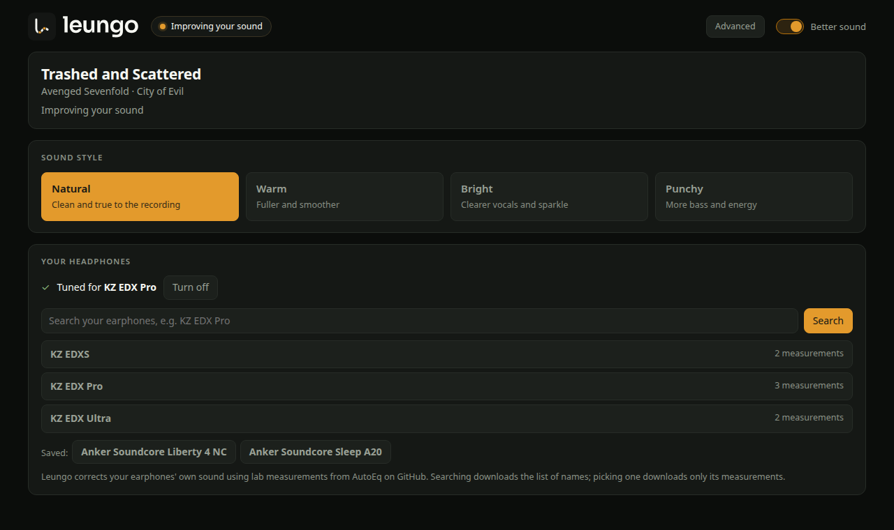
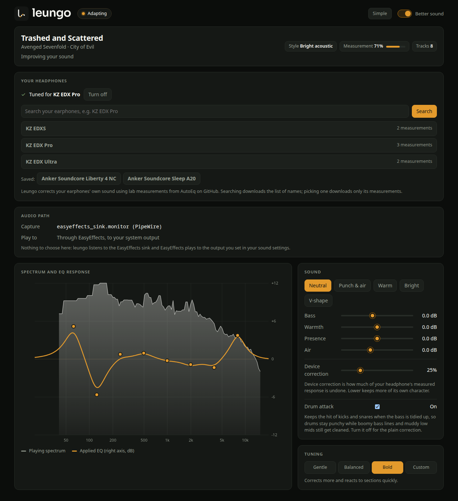

<p align="center">
  <picture>
    <source media="(prefers-color-scheme: dark)" srcset="assets/brand/svg/leungo-lockup-on-dark.svg">
    
  </picture>
</p>

# Leungo: an equalizer that tunes itself

Leungo is Acehnese for "listen".

Leungo sits between your music app and your headphones. It corrects your
headphones toward a reference sound, then measures each song as it plays and
evens out what is off in that mix: a boomy low end, a buried midrange, a harsh
peak. You don't touch an EQ, and nothing needs redoing when the next song
starts.

It works with Spotify, Apple Music, a browser, or anything else that plays
sound. Everything is plain signal processing (filters, spectra and
statistics). There is no machine learning, and your audio never leaves your
computer.

<p align="center">
  
</p>

| Platform | Status |
|---|---|
| Linux (PipeWire or PulseAudio) | Works. Uses EasyEffects to apply the EQ. `.deb`, `.rpm`, or build from source. |
| macOS (Apple silicon) | Early. Uses the BlackHole driver. Please report problems. |
| Windows 10 (2004 or later) and 11 | Early. Uses Equalizer APO to apply the EQ. Installer (`-setup.exe`) or `.zip`. Please report problems. |

## What it does to the sound

Three layers, applied together:

1. **Your headphones.** Every model has its own sound: extra bass, a sharp
   peak at 5 kHz, a dip somewhere. Pick your model in the dashboard and
   Leungo downloads its lab measurements, works out the difference from a
   reference curve (Harman in-ear 2019 with 4 dB more deep bass), and
   corrects it with up to 10 filters.
2. **The song.** Leungo measures the song's balance in 1/3-octave bands and corrects
   only what stands out from the song's own overall slope. A bass-heavy track
   stays bass-heavy; a track with a muddy 250 Hz hump gets that hump trimmed.
   Kick drums and snare hits keep their attack.
3. **Your taste.** Optional bass, warmth, presence and air controls on top.

Corrections are small and bounded. Leungo also turns the overall level down
by exactly as much as its largest boost, so it never clips.

The advanced view shows what it's doing: the spectrum of the playing song
(grey), the EQ it applied for that song (orange), and every control.

<p align="center">
  
</p>

## Get started

### Linux

Download the `.deb` or `.rpm` from the
[Releases page](https://github.com/rizqyep/leungo/releases):

```sh
sudo apt install ./leungo_<version>_amd64.deb        # Debian, Ubuntu, Mint
sudo dnf install ./leungo-<version>-1.x86_64.rpm     # Fedora and relatives
```

Then start EasyEffects, play something, and run `leungo gui`. If EasyEffects
is missing, the dashboard shows the install command for your distribution and
continues once it's there.

### macOS

1. Download `Leungo-<version>-macos-arm64.dmg` from the
   [Releases page](https://github.com/rizqyep/leungo/releases) and drag
   **Leungo** to Applications.
2. The app isn't signed with an Apple Developer ID yet. The first time,
   right-click **Leungo**, choose **Open**, then **Open** again.
3. If Leungo asks for BlackHole, click **Install BlackHole 2ch** and enter
   your password.
4. Allow the **Microphone** prompt. That's how Leungo hears what your Mac
   plays. Allow **Automation** too if you want track names from Spotify or
   Music.

While Leungo runs, your Mac's sound goes through it to your headphones. When
you close the window, the output goes back to how it was.

### Windows

1. Download `Leungo-<version>-windows-x64-setup.exe` from the
   [Releases page](https://github.com/rizqyep/leungo/releases) and open it.
   The build isn't signed yet, so Windows may say it protected your PC:
   click **More info**, then **Run anyway**.
2. Click through setup. If Equalizer APO (the free equalizer Leungo uses on
   Windows) is missing, setup downloads and opens its installer. When its
   device window appears, tick the device you listen on, such as your
   headphones, and click **OK**.
3. Restart Windows when setup asks. Leungo opens by itself afterwards; next
   time, open it from the Start menu.

Closing the Leungo window quits Leungo and switches its equalizer off.
Uninstall it from Settings, Apps; Equalizer APO is then put back the way it
was (uninstall Equalizer APO separately if you no longer want it). A `.zip`
with the same programs is there too, for running without installing.

Leungo listens to every app except itself and writes its EQ to
`leungo.txt` in Equalizer APO's config folder. The first time, it replaces
the demo `config.txt` the Equalizer APO installer leaves behind (saved as
`config.txt.before-leungo`); a `config.txt` you wrote yourself is kept, with
one `Include: leungo.txt` line added.

### Install with an AI coding agent

If you use Claude Code, Codex, Gemini CLI or a similar agent in a terminal,
paste this:

```text
Install Leungo from https://github.com/rizqyep/leungo on this computer.
Use the latest release from the Releases page, not the source, and pick the
right file for my OS (.dmg on macOS, .deb or .rpm on Linux, -setup.exe on Windows). Check the file
against its .sha256 before installing. On Linux, make sure EasyEffects is
installed too. Ask me before any command that needs sudo or my password.
When it's done, start it with `leungo gui` (Linux) or open the app (macOS),
and tell me what to click first. Follow the README's Get started section.
```

The agent can't approve macOS permission prompts (Microphone, Automation,
the BlackHole installer) for you; click those yourself.

### First use

1. In **Your headphones**, type your model (for example "KZ EDX Pro") and
   click it. The correction is applied straight away, mid-song.
2. Pick a **Sound style** if you want one. Natural is the default.
3. Flip **Better sound** off and on to compare.

If your model isn't listed, it hasn't been measured by any source AutoEq
collects. Leungo still adjusts each song; it just can't correct the
headphones themselves yet (see the [roadmap](ROADMAP.md)).

## Privacy

Audio is analyzed on your computer and never sent anywhere. The only network
use is the headphone search: Leungo downloads the list of measured models
from the [AutoEq](https://github.com/jaakkopasanen/AutoEq) project on GitHub
(refreshed monthly), and the measurement files of the model you pick. GitHub
sees those requests, including the model name.

## If something is wrong

| What you see | What to do |
|---|---|
| "Waiting for music" never changes (macOS) | Check that Leungo has the Microphone permission in System Settings, Privacy & Security. |
| No sound at all (macOS) | Quit Leungo, run `/Applications/Leungo.app/Contents/MacOS/leungo-bin restore`, and reopen it. |
| macOS says the app is "damaged" | Run `xattr -dr com.apple.quarantine /Applications/Leungo.app` once. |
| Video slightly out of sync (macOS) | Leungo adds about 60 ms of delay. Quit it while watching video if that bothers you. |
| Nothing changes in the sound (Windows) | Equalizer APO only runs on the devices ticked in its Device Selector, and only after a restart. Run `leungo setup` to check the current output. |
| No track names (Windows) | Leungo reads the media controls Windows shows next to the volume flyout. The Spotify desktop app only appears there with "Show desktop overlay when using media keys" on. |
| It sounds thin | Raise **Bass** in the Sound card, or lower **Device correction** to keep more of your headphones' own character. |

Bug reports help most with the song, the headphones, what sounds wrong, and
the first lines printed by `leungo gui`.

## Command line

```sh
leungo gui                 # engine + dashboard at http://127.0.0.1:8431
leungo run                 # engine only
leungo status              # what it's doing and the current EQ
leungo bypass on|off       # compare with the original
leungo sound --bass 3      # taste controls (bass, warmth, presence, air, device)
leungo tuning balanced     # conservative, balanced, aggressive or custom
leungo device a.csv b.csv  # fit your own measurement files
leungo analyze song.wav    # run the analysis on a 48 kHz WAV, no playback
leungo config-path         # where the config lives
```

The config file and every setting are described in
[TECHNICAL.md](TECHNICAL.md#configuration).

## Build from source

You need Rust 1.85 or newer. On Linux also PipeWire (with `pipewire-pulse`) or
PulseAudio, and EasyEffects 7 or 8. On macOS, the Xcode command line tools.

```sh
git clone https://github.com/rizqyep/leungo.git
cd leungo
cargo build --release -p leungo-cli
target/release/leungo gui
```

## Known limits

- Only headphones that AutoEq has measurements for get a device correction.
  Many true wireless models aren't measured.
- One headphone profile is active at a time. Leungo doesn't yet switch when
  you change outputs.
- Most of the tuning numbers (dead zone, strengths, drum thresholds) were set
  by listening on one setup and haven't been tested blind. That's the main
  open work.
- On macOS the processing adds about 60 ms of latency, and the drift
  correction between the two audio clocks hasn't been tested over long
  sessions on many machines.

## More

- [TECHNICAL.md](TECHNICAL.md): how it works, with the equations and the
  research it builds on.
- [ROADMAP.md](ROADMAP.md): what's next, and where help is wanted.
- [CONTRIBUTING.md](CONTRIBUTING.md): setup, checks, and how to report
  problems.
- [CHANGELOG.md](CHANGELOG.md): what changed in each release.
