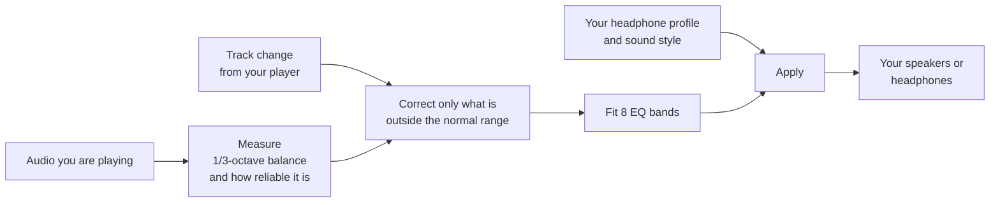

<p align="center">
  <picture>
    <source media="(prefers-color-scheme: dark)" srcset="assets/brand/svg/leungo-lockup-on-dark.svg">
    
  </picture>
</p>

# Better sound from any music app, automatically

Leungo is Acehnese for "listen".

Open Leungo, play music in Spotify, Apple Music or any other app, and it adjusts the
sound for you. It listens to each song, works out whether it is bass-heavy, vocal-led,
bright or balanced, and quietly tunes the equalizer to match. You never touch an EQ,
and you never have to redo it when the next song comes on.

- **Hands-off.** It re-tunes on every track change. There is nothing to configure.
- **Four sound styles.** Natural, Warm, Bright or Punchy: pick the one you like.
- **One switch to compare.** Turn "Better sound" off and on to hear the difference.
- **Works with what you already use.** Any app that plays through your speakers or
  headphones, with no plug-ins and no per-app setup.
- **Private.** Everything runs on your computer. Nothing is uploaded and the
  dashboard loads nothing from the internet.

An advanced view is there if you want spectrum graphs, per-band control and tuning
presets. It is off by default.

| Platform | Status |
|---|---|
| macOS (Apple silicon) | Available as an app. Early release: please report problems. |
| Linux (PipeWire or PulseAudio) | Working. Needs EasyEffects. `.deb`, `.rpm` or build from source. |
| Windows | Planned |

## Get started

### macOS

1. Download `Leungo-<version>-macos-arm64.dmg` from the
   [Releases page](https://github.com/rizqyep/leungo/releases) and drag **Leungo** to
   Applications.
2. Open it. The app is not signed with an Apple Developer ID yet, so macOS blocks the
   first launch: right-click **Leungo**, choose **Open**, then **Open** again.
3. If Leungo asks for the BlackHole audio driver, click **Install BlackHole 2ch**,
   enter your password, and restart your Mac if the installer asks. Leungo carries on by
   itself once the driver is there.
4. Allow the **Microphone** prompt (this is how Leungo hears what your Mac is playing)
   and, if you want track names, the **Automation** prompt for Spotify or Music.
5. Play some music.

That is the whole setup. While Leungo runs it routes your Mac's sound through itself and
plays it to your headphones or speakers. When you close the Leungo window it quits and
puts your sound output back exactly as it was.

### Linux

**Easiest: install a package.** Download the `.deb` or `.rpm` for x86_64 from the
[Releases page](https://github.com/rizqyep/leungo/releases):

```sh
sudo apt install ./leungo_<version>_amd64.deb        # Debian, Ubuntu, Mint
sudo dnf install ./leungo-<version>-1.x86_64.rpm     # Fedora, RHEL and relatives
```

Both packages recommend `easyeffects`, which is what applies the equalizer. If it
is missing, `leungo gui` shows a setup screen with the install command for your
distribution (and `leungo setup` prints it); the dashboard continues by itself
once EasyEffects is installed. Leungo does not install it for you, because that
needs administrator rights.

To build it yourself instead you need PipeWire (with `pipewire-pulse`) or
PulseAudio, EasyEffects 7 or 8 with the `easyeffects` command on `PATH`, a Rust
toolchain (1.85 or newer) and a C linker.

```sh
git clone https://github.com/rizqyep/leungo.git
cd leungo
cargo build --release -p leungo-cli
install -Dm755 target/release/leungo ~/.local/bin/leungo
```

Start EasyEffects, play something, then run `leungo gui`. The dashboard opens at
`http://127.0.0.1:8431`.

## Using Leungo

**Simple view** (the default) shows what is playing, a **Better sound** switch, the
four sound styles and where the sound goes. Choose a style and you are done.

- **Sound style:** Natural keeps the recording as it is. Warm is fuller and smoother.
  Bright brings out vocals and sparkle. Punchy adds bass and energy.
- **Play through:** "Automatic" follows whatever your Mac is using, so plugging in
  headphones just works. Pick a specific device to pin it.
- **Better sound off:** plays the original, untouched, so you can compare.

**Advanced view** (the button at the top right) adds the live spectrum, the applied EQ
curve, per-band sound controls, tuning presets and the capture device.

## If something is not right

| What you see | What to do |
|---|---|
| "Waiting for music" | Start playing in your music app. If it never changes, check that the Microphone permission is allowed for Leungo in System Settings, Privacy & Security. |
| No sound at all | Close Leungo, then run `/Applications/Leungo.app/Contents/MacOS/leungo-bin restore` in Terminal to put the output back, and reopen Leungo. |
| macOS says the app is "damaged" | Run `xattr -dr com.apple.quarantine /Applications/Leungo.app` once in Terminal, then open it again. |
| Volume keys | They work as usual and change the volume of your headphones or speakers. |
| Video looks slightly out of sync | Leungo adds about 60 ms of delay. It is not noticeable for music; quit Leungo while watching video if it bothers you. |
| Headphones unplugged | Leungo moves to another output (such as the built-in speakers) and follows your Mac when you plug a device back in. |

Reports are most useful with the first lines of the output from
`/Applications/Leungo.app/Contents/MacOS/leungo-bin gui` and
`/Applications/Leungo.app/Contents/MacOS/leungo-bin devices`.

---

# For tinkerers

Everything below is reference material: how the analysis works, the command line, the
config file and building from source.


## How it works

Leungo listens to what is playing, measures its tonal balance, and applies a
small, bounded 8-band EQ correction for that track, on top of an optional
correction for your headphones. It does not push every song toward one curve:
a song's own tilt is left alone, and only bumps and dips outside a dead zone are
corrected.



New tracks switch at once. In-track refinement is slow and switched in at quiet
moments. The technical details (measurement, the solver, the state machine,
what is verified and what is not) are in [TECHNICAL.md](TECHNICAL.md).

## Device profile

Run `leungo device <files>` with one or more AutoEq `ParametricEQ.txt`
files of your headphones or IEMs. Several sources are averaged, so one unit or
coupler does not decide the result. The averaged curve is fitted onto the 8
bands and written to `eq.device_curve`. The largest gain is shifted to 0 dB
(the printed "level offset") so it cannot clip. Eight broad bands cannot
reproduce narrow high-Q notches; the printed fit error shows how close the fit
gets. `eq.device_strength` (default 0.6) scales how much of that curve is
applied.

Getting the files: browse
<https://github.com/jaakkopasanen/AutoEq/tree/master/results>, open the
source, then the form factor folder (`in-ear`, `over-ear`), then your model,
and download `<model> ParametricEQ.txt`. Download the same model from two or
three sources if they exist, then:

```sh
leungo device ~/Downloads/*ParametricEQ.txt
```

The repository does not ship any profile data. AutoEq is MIT licensed; the
licensing of the underlying measurement data was not checked.


## Usage

```sh
# daemon + browser GUI (opens http://127.0.0.1:8431)
leungo gui

# headless daemon
leungo run

# in another terminal
leungo status          # state, archetype, confidence, current EQ
leungo bypass on|off   # pause adaptation, restores the previous curve

# import your existing manual EQ as the base curve
leungo calibrate <preset-name-or-path>

# analyze a 48 kHz WAV offline, no playback needed
leungo analyze song.wav

leungo config-path     # where the config lives
```

The GUI is a local web page served by the daemon itself (no external
resources, nothing leaves the machine). It shows the live state, the playing
spectrum, the applied EQ response, and has a bypass toggle. From a terminal the
daemon keeps adapting when you close the tab; the macOS app (or `--quit-on-close`)
quits when its window closes.

Start EasyEffects first (service mode is fine). The daemon writes the preset
`~/.local/share/easyeffects/output/leungo.json` and loads it whenever a
new track is classified. The preset carries both the EasyEffects 7 (`equalizer`)
and 8 (`equalizer#0`) setting keys, so one file works across versions.


## Config

`~/.config/leungo/config.toml` is created with defaults on first run.

```toml
[analysis]
window_s = 6.0            # audio analyzed per track before classifying
gap_s = 1.2               # silence gap that counts as a track change
silence_threshold_db = -60.0
minimum_change_db = 1.0   # skip refinement steps smaller than this
defer_max_s = 10.0        # wait up to this long for a quiet moment before switching, 0 = at once
defer_dip_db = 4.0        # a frame this far below the recent level is a quiet moment
shape_window_s = 20.0     # seconds of recent audio the spectral shape is measured over (median across frames)
refine_interval_s = 5.0   # seconds between slow refinement passes while a track plays, 0 = off
refine_alpha = 0.35       # fraction of the remaining distance taken per pass
refine_max_step_db = 1.5  # largest per-band change per pass

[eq]
frequencies = [63.0, 125.0, 250.0, 500.0, 1000.0, 2000.0, 4000.0, 8000.0]
q = 1.41
clamp_db = 12.0
strength = 0.5             # fraction of the deviation corrected, 0..1
base_curve = [0.0, 0.0, 0.0, 0.0, 0.0, 0.0, 0.0, 0.0]  # your manual IEM EQ
device_curve = [0.0, 0.0, 0.0, 0.0, 0.0, 0.0, 0.0, 0.0]  # fixed headphone/IEM correction, applied in full; written by `leungo device`
deadzone_db = 2.0          # deviations from the track's own tilt smaller than this are left alone
residual_cap_db = 6.0      # largest deviation the adaptive layer will chase
percussive_relief = 0.5   # fraction the bass/treble correction is reduced for fully percussive material, 0 = off

[targets]                  # dB deltas per archetype, at eq.frequencies
bass_heavy     = [1.5, 1.5, 0.5, 0.0, 0.0, -0.5, -1.0, -0.5]
vocal_centric  = [0.0, 0.0, 0.3, 0.8, 0.8, 0.3, 0.0, 0.0]
guitar_band    = [0.5, 0.5, 0.8, 0.8, 0.8, 0.3, -1.0, -0.5]
bright_acoustic= [0.0, 0.0, 0.0, 0.0, 0.0, -0.5, -1.0, -1.0]
neutral        = [0.0, 0.0, 0.0, 0.0, 0.0, 0.0, 0.0, 0.0]
```

Other settings:

```toml
[gui]
port = 8431
open = "app"        # app: its own window, browser: a tab, none: print the address

[standalone]        # macOS only
input_device = "BlackHole"
output_device = ""  # empty follows the system; a name pins that device
latency_ms = 60
manage_output = true  # point the system output at the loopback device while running
```

`gui.open = "app"` uses a Chromium-family browser (Chrome, Chromium, Brave,
Edge) in app mode when one is installed: a window with no tabs or address
bar. It is still a browser process underneath, so it uses the browser's
memory while open. Started from the app bundle, closing the window quits Leungo.
From a terminal the daemon keeps running unless you pass `--quit-on-close`.

Tuning tips:

- If the adaptive layer fights your taste, adjust `targets`: positive values
  let that archetype keep more energy in a region, negative values lean
  against it. Positive bass values on `bass_heavy` mean "let EDM keep its
  low end", not "add bass".
- Run `calibrate` once with the preset you already use, so your IEM
  corrections are baked into `base_curve`.
- `strength` is the main taste knob. 0.3-0.5 keeps most of the mastering
  intent, 1.0 flattens every track toward the target. A less repeatable
  measurement (lower reliability) shrinks it further.
- In-track curve changes are held until a dip in level (a rest, a breath, a
  phrase gap) so the switch is hidden, or until `defer_max_s` passes. New
  tracks apply immediately.
- A new track (next or previous in the player) is always analyzed from scratch
  and its curve is applied at once. Pausing and resuming the same track does
  nothing.
- While a track plays the curve is refined slowly: small steps every
  `refine_interval_s`, only when the change is audible (`minimum_change_db`),
  and switched in at a quiet moment (`defer_dip_db`, `defer_max_s`).
- Capture reads `easyeffects_sink.monitor` (the signal before the EQ) when
  EasyEffects is running, so the analysis never measures its own correction.
- Confidence is a margin between the two closest archetypes and is usually low
  with the built-in prototypes. Run `leungo fit` after about 30 tracks to
  fit prototypes to your own listening. It prints the mean confidence before
  and after. The number shows how typical a track is of its group, not whether
  the group is right.

Devices picked in the dashboard are stored in `devices.json`, and the Simple/Advanced
choice in `ui.json`, next to `config.toml`, so the file you edit by hand is never
rewritten.


## Tuning presets

Presets bundle eight settings: `eq.strength`, `eq.deadzone_db`, `eq.residual_cap_db`, `analysis.refine_interval_s`, `analysis.refine_alpha`, `analysis.refine_max_step_db`, `analysis.defer_max_s`, `analysis.shape_window_s`. The device curve, targets and capture settings are never changed.

| preset | strength | dead zone dB | cap dB | refine every s | alpha | max step dB | defer max s | shape window s |
|---|---|---|---|---|---|---|---|---|
| conservative | 0.35 | 3.0 | 4.0 | 8 | 0.25 | 1.0 | 12 | 30 |
| balanced | 0.5 | 2.0 | 6.0 | 5 | 0.35 | 1.5 | 10 | 20 |
| aggressive | 0.8 | 1.0 | 8.0 | 2 | 0.5 | 2.5 | 6 | 10 |

Choose a preset in the dashboard dropdown or run `leungo tuning conservative|balanced|aggressive|custom`. With no argument, the command prints the current preset. A running daemon applies the change within about a second and re-solves immediately. `custom` uses the values written in the config file. A `tuning = "balanced"` line at the top of the config sets the default preset.

The values are starting points that have not been tuned by listening.

## Sound

The dashboard has a Sound card with presets (Neutral, Punch & air, Warm,
Bright, V-shape), four controls and a device-correction slider.

- `bass`: -6 to +8 dB, low shelf below about 110 Hz.
- `warmth`: -4 to +4 dB, bump near 220 Hz.
- `presence`: -4 to +4 dB, bump near 3 kHz.
- `air`: -4 to +6 dB, high shelf from about 5.5 kHz. The highest of the 8
  bands is 8 kHz, so a shelf cannot start higher.
- Device correction: 0 to 100% (`eq.device_strength`, default 0.6). It scales
  how much of the headphone correction is applied.

The sound controls are applied on top of the correction and take effect
within about a second. They are shifted so the signature never adds a net
boost, so they add no extra clipping risk.

`leungo sound` prints the current values. `leungo sound --bass 4 --air 3
--device 0.6` sets them. Negative values work, for example `--warmth -2`.

The values are stored in the config under `[eq.signature]` as `bass_db`,
`warmth_db`, `presence_db` and `air_db`.

The dashboard tuning buttons are labelled Gentle, Balanced, Bold and Custom.
They map to the conservative, balanced, aggressive and custom presets.

## Fitting to your listening

- The daemon logs descriptors of each analyzed track to `~/.local/share/leungo/tracks.jsonl`.
- `leungo fit` needs at least 30 tracks in two or more groups.
- It writes `~/.config/leungo/classifier.json`.
- Restart the daemon to use it.

## Architecture

A small platform-independent core (analysis, EQ solver, engine) sits between a
per-platform audio source and EQ applier, so Linux (EasyEffects) and macOS
(in-process, BlackHole) share the same engine. The crate layout, data flow and
diagrams are in [TECHNICAL.md](TECHNICAL.md#crates).

## macOS from source

```sh
xcode-select --install                    # compiler and linker
curl https://sh.rustup.rs -sSf | sh       # Rust 1.85 or newer
git clone https://github.com/rizqyep/leungo.git
cd leungo
cargo build --release -p leungo-cli
target/release/leungo gui
```

`leungo setup` installs the BlackHole driver from the terminal, `leungo devices`
lists audio devices and `leungo restore` puts the system output back after an unclean
exit. Set `standalone.manage_output = false` to switch the output yourself.

On macOS leungo captures a virtual loopback device (BlackHole), equalizes in process
and plays the result to your real output. Track information comes from polling Spotify
and Music with AppleScript.

macOS limitations:

- The processing adds about the configured `latency_ms` of delay.
- BlackHole has a volume of its own. While Leungo runs, BlackHole's volume follows your
  real output's volume, its attenuation is made up digitally, and each volume-key press
  is copied onto the real output device. Mute is passed through as silence.
- Only 32-bit float devices are supported, which is what CoreAudio normally offers.
- The two devices run on separate clocks. A small controller absorbs the difference; it
  is unit-tested against simulated drift, so occasional clicks are possible.
- A config from an earlier build lives under `~/Library/Application Support/leungo`.


## Known limitations

- 2048-point FFT at 48 kHz puts the effective analysis floor at ~50 Hz; deeper
  bass corrections come from the 63/125 Hz bands.
- Track changes come from the player (MPRIS) when available, otherwise from
  silence gaps. A player without metadata that crossfades gaplessly may not be
  detected. Continuous mixes with 30+ second gaps between changes work; shorter
  crossfades may skip a re-analysis (by design, to avoid false triggers from
  notifications).
- The classifier is rule-based on spectral signatures. It is transparent and
  fast, but the guitar-band vs neutral boundary is fuzzy; an ML classifier is
  a later upgrade (see roadmap).
- WAV analysis expects 48 kHz; resample other rates first.


## Roadmap

1. Windows: WASAPI loopback capture + Equalizer APO config writer
2. macOS: a menu-bar item and a signed, notarized app bundle
3. ML archetype classifier (ONNX runtime, distilled model)
4. Library pre-scan cache for instant presets on known tracks
5. Native window front end (egui) beside the web GUI; needs GUI dev headers
   (wayland-client, libxkbcommon, gtk3) that are not currently installed here
6. Optional standalone Linux mode: PipeWire virtual sink with in-process DSP


## Development

```sh
cargo test --workspace
cargo clippy --workspace --all-targets -- -D warnings
```

- [TECHNICAL.md](TECHNICAL.md): how the engine, measurement and solver work, and what is not verified.
- [CONTRIBUTING.md](CONTRIBUTING.md): setup, checks, platform-specific code, and how to report problems.
