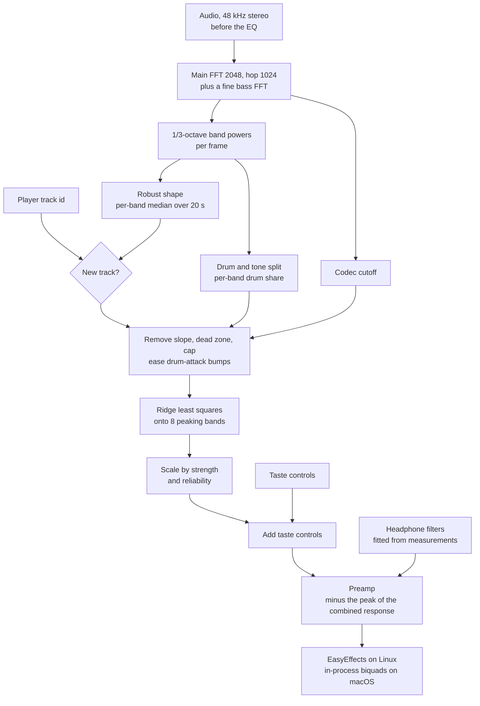
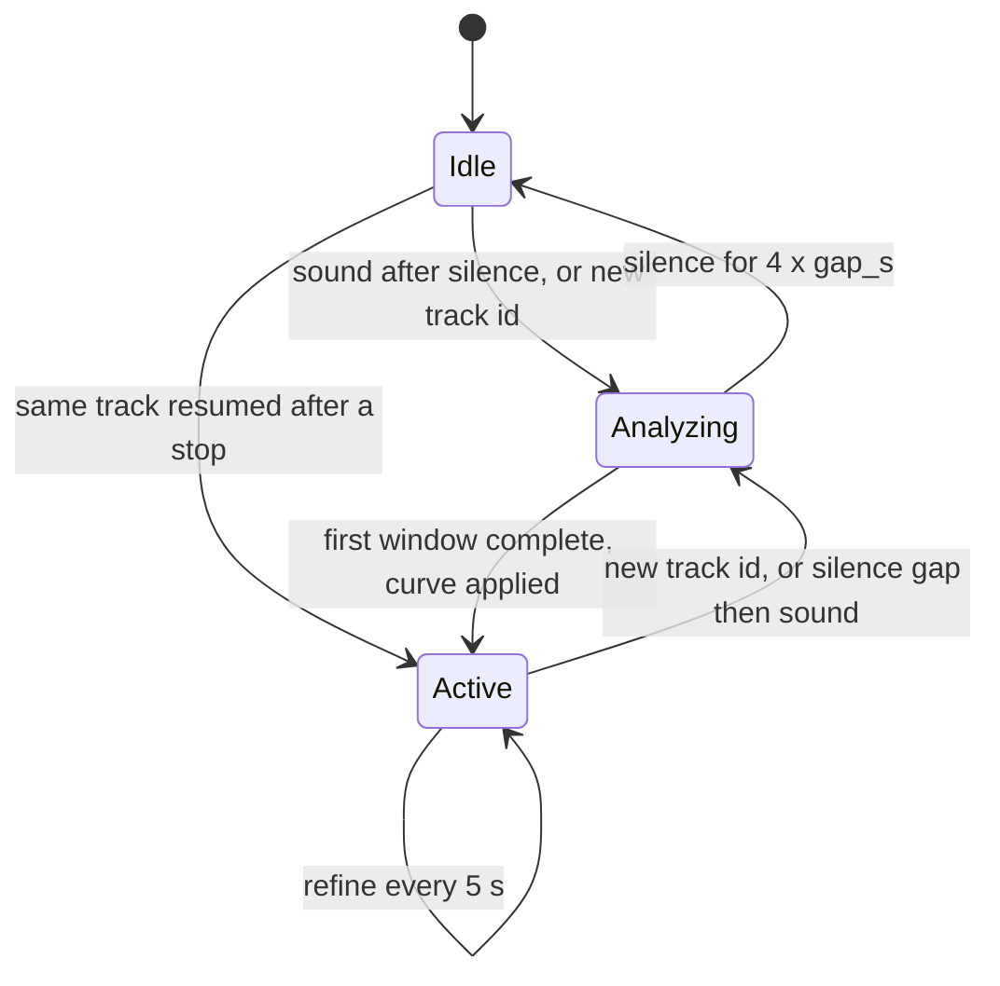

# How Leungo works

This is the reference for how Leungo measures music, decides on a curve and
applies it. For installing and using it, see the [README](README.md). For
changing it, see [CONTRIBUTING.md](CONTRIBUTING.md). For what's planned, see
[ROADMAP.md](ROADMAP.md).

Numbers are the shipped defaults, from `crates/leungo-core/src/config.rs`
unless another file is named. Anything marked *unverified* hasn't been checked
against blind listening or real hardware.

Contents:

1. [The idea](#the-idea)
2. [Data flow](#data-flow)
3. [Theory and equations](#theory-and-equations)
4. [Measurement](#measurement)
5. [The song layer](#the-song-layer)
6. [The headphone layer](#the-headphone-layer)
7. [The engine](#the-engine)
8. [Platform backends](#platform-backends)
9. [Configuration](#configuration)
10. [Files, dashboard API, crates](#files-dashboard-api-crates)
11. [Testing and verification](#testing-and-verification)
12. [Known gaps](#known-gaps)
13. [References](#references)

## The idea

Leungo applies three EQ layers and keeps them separate, because each one has
a different source of truth:

| Layer | Corrects | Comes from | Changes |
|---|---|---|---|
| Headphone | The headphones' own frequency response | Lab measurements (AutoEq) fitted toward a target | Once per headphone model |
| Song | Bumps and dips in this mix that stand out from its own slope | Live measurement of the playing audio | Per track, refined slowly |
| Taste | Bass, warmth, presence, air | The user | When the user moves a control |

Two decisions shape everything else:

- **A song's overall slope is left alone.** Music has more energy in the bass
  than the treble, and the slope differs by genre and era. Correcting every
  song toward "flat" would make every real recording look wrong. Leungo fits
  the slope, subtracts it, and only corrects what's left over.
- **The headphone layer uses free filters, the song layer fixed ones.** A
  headphone resonance can be narrow (a 5 kHz peak in an IEM), so the
  headphone stage places its own filters at any frequency, width and gain. The
  song layer uses 8 fixed, broad bands, because a mix imbalance is broad and
  a fixed set keeps changes smooth between songs.

## Data flow



Capture always takes the signal *before* Leungo's EQ, so the analysis never
measures its own correction.

## Theory and equations

Everything here is standard DSP, statistics or published listening research.
Sources are in [References](#references).

### Filters: RBJ biquads

Every filter, in both layers and on both platforms, is a second-order IIR
filter (biquad) with coefficients from Robert Bristow-Johnson's Audio EQ
Cookbook [1]. For a peaking filter at centre frequency $f_0$, gain $G$ dB and
quality factor $Q$, at sample rate $f_s$:

$$
A = 10^{G/40}, \qquad \omega_0 = \frac{2\pi f_0}{f_s}, \qquad \alpha = \frac{\sin\omega_0}{2Q}
$$

$$
H(z) = \frac{(1 + \alpha A) - 2\cos\omega_0  z^{-1} + (1 - \alpha A)  z^{-2}}
            {(1 + \alpha/A) - 2\cos\omega_0  z^{-1} + (1 - \alpha/A)  z^{-2}}
$$

Low and high shelves use the cookbook's shelf formulas with the same $A$,
$\omega_0$ and $\alpha$ ("Q form"). `crates/leungo-dsp/src/lib.rs` has all
three.

The response of a chain of filters is the product of their transfer
functions, so in decibels it's a sum:

$$
H_{\text{dB}}(f) = \sum_i 20\log_{10}\left|H_i\left(e^{j 2\pi f/f_s}\right)\right|
$$

That sum is what the solvers fit and what the preamp checks. On Linux,
EasyEffects runs the same cookbook math (mode `APO (DR)`). Measured on
EasyEffects 8.2.8 with white noise, its response matched this model within
0.04 dB rms (worst point 0.16 dB at 80 Hz).

### Spectrum: STFT and 1/3-octave bands

The short-time Fourier transform takes frames of $N = 2048$ samples every
$1024$ samples, with a Hann window $w[n] = \tfrac12\left(1 - \cos\tfrac{2\pi n}{N}\right)$.
At 48 kHz each bin is $f_s/N \approx 23.4$ Hz wide.

Bin powers $|X[k]|^2$ are grouped into 1/3-octave bands at the IEC 61260
nominal centres (25 Hz, 31.5 Hz, 40 Hz, … 16 kHz). A band from $f_\text{lo}$
to $f_\text{hi}$ sums each bin weighted by the share of that bin lying inside
the band:

$$
P_b = \sum_k \omega_{b,k} |X[k]|^2, \qquad
\omega_{b,k} = \frac{\big|[f_k - \tfrac{\Delta f}{2},  f_k + \tfrac{\Delta f}{2}] \cap [f_\text{lo}, f_\text{hi}]\big|}{\Delta f}
$$

Summing whole bins instead gave false bumps of up to 1.4 dB at 315 to 630 Hz
on pink noise.

Each frame's band levels are normalized by that frame's total level, so
playback volume doesn't change the result.

### Bass resolution: decimation

23 Hz bins can't separate 63 Hz from 80 Hz. Bands up to 250 Hz therefore come
from a second path: a 97-tap Blackman-windowed sinc lowpass (3 kHz cutoff),
decimation by $D = 8$ to 6 kHz, then a 2048-point Hann FFT every 512
decimated samples. Bins are now $6000/2048 \approx 2.9$ Hz wide. The lowpass
is flat to 300 Hz and more than 60 dB down wherever energy would alias into
0 to 300 Hz.

### A robust spectral shape: the median, and its bias

The song's shape is the per-band **median** of the frame levels over the last
20 s, not the mean, so a few loud hits can't move it. The median of
noise-like power is biased low, though. Power summed over $n$ bins with a
Hann window behaves like a chi-square variable with $k = 2n/1.5$ degrees of
freedom (1.5 bins is the Hann window's noise bandwidth). The Wilson-Hilferty
approximation [5] gives its median as about $k\left(1 - \tfrac{2}{9k}\right)^3$
against a mean of $k$, so each band gets a correction of

$$
\Delta_b = -30\log_{10}\left(1 - \frac{2}{9k}\right) \text{ dB}
$$

That's about 1.4 dB for a one-bin band and 0.03 dB for a hundred bins.
Without it, the deepest bands read low and the song layer boosted bass that
wasn't missing.

Frames more than 10 dB below the median frame level are left out (gating),
so quiet passages don't dilute the shape.

### Reliability

The gated frames are split into a first and second half, a shape is measured
from each, and the rms difference $\sigma$ between the two shapes (after
removing their mean offset) gives

$$
\rho = \mathrm{clamp}\left(1 - \frac{\sigma}{6~\text{dB}},~0,~1\right)
$$

$\rho = 1$ means the measurement is repeatable. It scales how much is
corrected (see below). It says nothing about whether the result sounds good.

### The song's slope: Theil-Sen

With $x_i = \log_2 f_i$ and $y_i$ the band levels, the slope is the median of
all pairwise slopes, and the intercept the median of what's left [6, 7]:

$$
\hat\beta = \underset{i \lt j}{\mathrm{median}}\frac{y_j - y_i}{x_j - x_i}, \qquad
\hat\alpha = \underset{i}{\mathrm{median}}\left(y_i - \hat\beta x_i\right)
$$

An ordinary least-squares line gets pulled toward a wide bass bump and then
cancels the correction for that same bump. The median-based line ignores up
to about 29% outlying points.

### Residual: dead zone and cap

The residual $r_i = y_i - (\hat\alpha + \hat\beta x_i)$ is passed through a
soft threshold with dead zone $d = 2$ dB and clamped to the cap $c = 6$ dB:

$$
\tilde r_i = \mathrm{clamp}\Big(\mathrm{sign}(r_i)\max(|r_i| - d,~0),~-c,~c\Big)
$$

Small deviations are normal variation between songs and are left alone.
Only bands from 40 Hz to the upper limit get any correction. The upper limit
is 10 kHz, or a third of an octave below the codec's cutoff when the stream
is lowpassed lower than that.

### Drum attack: harmonic/percussive separation

Fitzgerald's median-filtering method [3] splits the spectrogram into tonal
and percussive parts. Tones are steady over time; drum hits are short and
spread across frequency. For each bin, a median across 17 frames (about
0.36 s) estimates the harmonic part $H$, and a median across 17 bins (about
400 Hz) estimates the percussive part $P$. A soft (Wiener-style) mask splits
the bin's power:

$$
m_P = \frac{P^2}{H^2 + P^2}
$$

Averaged over the track, this gives each band a drum share $s_b \in [0,1]$.
With **Drum attack** on, a bump (a positive residual, which would be cut) is
eased in proportion to how drum-led it is, but only where drum attack lives:

$$
\tilde r_b \leftarrow \tilde r_b\Big(1 - \lambda~\pi(s_b)~z(f_b)\Big), \qquad
\pi(s) = \mathrm{clamp}\left(\frac{s - 0.4}{0.35}, 0, 1\right)
$$

$\lambda = 0.5$ is `percussive_relief`. The zone weight $z(f)$ is 1 for the
kick (40 to 125 Hz) and for click and snare (2 to 5 kHz), fading to 0 over
half an octave on each side. It's 0 from 180 Hz to 1.4 kHz, so a boomy bass
line or muddy low mids are still cut. Dips are never eased. The thresholds
0.4 and 0.75 are *unverified*; short bass notes read partly percussive, which
is why the lower threshold is well above 0.

### Fitting the 8 song bands: ridge least squares

The 8 peaking bands sit at 63, 125, 250, 500 Hz and 1, 2, 4, 8 kHz with
$Q = 1.41$. The wanted change at each band centre is
$d_k = t_k - \tilde r_k$, where $t$ is the target (a small per-style offset,
at most 1.5 dB). Its mean is removed, since overall level is loudness, not
tone, and a peaking EQ can't apply a constant shift. Then the gains $g$ solve

$$
\min_{g, o}~\sum_k\Big(\sum_j a_{kj} g_j + o - d_k\Big)^2 + \lambda\sum_j g_j^2,
\qquad a_{kj} = \frac{H_{j,\text{dB}}(f_k;  g_j)}{g_j}
$$

with ridge $\lambda = 0.05$ and a free offset $o$. $a_{kj}$ is band $j$'s
response in dB per dB of gain, which depends a little on the gain itself, so
the solve runs twice, linearized at the previous result, clamping each gain to
±12 dB. The normal equations are solved directly (Gaussian elimination).

The song correction is then scaled:

$$
g_\text{song} = s (0.5 + 0.5\rho) g
$$

with strength $s = 0.5$. The taste controls are added, and each band is
clamped to ±12 dB.

### The headphone layer: target, consensus, correction

**Target.** Harman in-ear 2019 [2] plus a low shelf at 105 Hz, +4 dB,
$Q = 0.7$. Harman's research found the base curve is what the average
listener prefers in blind tests, and that a large group prefers more bass
than that. The shelf adds weight below about 120 Hz without touching 200 to
400 Hz, where extra bass sounds boomy. Both curves are normalized so 500 Hz
to 1 kHz averages 0 dB.

**Consensus.** Every measurement source for the model (Super Review,
RikudouGoku, and others) is resampled onto a 1/12-octave grid from 20 Hz to
20 kHz and normalized the same way. Per point, the combined response is the
median across sources, and the spread $\sigma$ is the scaled median absolute
deviation $1.4826\cdot\mathrm{MAD}$ for three or more sources, or
$|x_1 - x_2|/\sqrt2$ for two. Each point gets a weight

$$
w = \frac{1}{1 + (\sigma/1.5~\text{dB})^2}
$$

so the fit trusts the response less where the sources disagree. The 1.5 dB
is *unverified*. With a single source, $w$ falls from 1 to 0.5 between 6 and
10 kHz, where coupler measurements are least reliable.

**Correction.** $c = w (T - M)$, smoothed over 3 grid points. A boost may
rise at most 3 dB above the median of its 1/3-octave neighbourhood: narrow
dips in an in-ear measurement are mostly ear-canal resonances that EQ can't
fill. Above 8 kHz the correction fades to 0 at 12 kHz, because treble varies
with insertion depth. The result is clamped to +6 / −12 dB.

### Fitting the headphone filters: greedy placement and Levenberg-Marquardt

The fitter finds filters $\theta = \lbrace (\text{type}_i, f_i, G_i, Q_i) \rbrace$ and a
level offset $o$ that minimize

$$
E(\theta, o) = \sum_k w_k\Big(H_{\text{dB}}(f_k;\theta) + o - c_k\Big)^2 + 0.05\sum_i G_i^2
$$

The gain penalty stops two large filters from cancelling each other. The
offset is thrown away afterwards, because level is the preamp's job.

1. Start with a low shelf (105 Hz) and a high shelf (10 kHz) at 0 dB and
   refine them.
2. Add a peaking filter at the largest remaining error, with $Q$ from the
   error's width at half height. Refine all parameters together with
   Levenberg-Marquardt [8] (numerical Jacobian, at most 200 iterations,
   parameters kept within the limits below).
3. If the new filter improves the rms error by less than 0.1 dB, drop it,
   mark that frequency span as tried, and try the next-largest error.
4. Stop at 0.5 dB rms error or 8 peaking filters. Remove filters under
   0.1 dB.

| Filter | Limits |
|---|---|
| Count | one low shelf, one high shelf, up to 8 peaking |
| Low shelf $f_c$ | 30 to 300 Hz |
| High shelf $f_c$ | 2 to 16 kHz |
| Shelf $Q$ | 0.4 to 0.9 |
| Peaking $f_c$ | 20 Hz to 12 kHz |
| Peaking $Q$ | 0.4 to 6; the maximum falls to 2 between 5 and 10 kHz, since treble peaks move with insertion depth (*unverified*) |
| Gain | ±12 dB |

Result on a KZ EDX Pro (Super Review and RikudouGoku): 7 filters, 0.27 dB rms
error from 20 Hz to 8 kHz. The 8 fixed song bands fitting the same
correction reach 1.12 dB rms.

### Headroom: the preamp

Boosting any frequency can push peaks above full scale. After every change,
Leungo evaluates the combined response of song bands, taste controls and
headphone filters on a 1/24-octave grid from 20 Hz to 20 kHz, and sets

$$
\text{preamp} = -\max\Big(0,~\max_f H_{\text{dB}}(f)\Big)
$$

So the EQ as a whole never adds gain at any frequency. The cost: with
Leungo on, music plays a little quieter than with it off. When comparing on
and off, the quieter one tends to sound worse at first.

### Codec edge

Lossy streams often cut the treble at 15, 16 or 19 kHz. From the mean power
spectrum of the track's audible frames, smoothed to 1/12 octave, the edge is
the highest frequency above 4 kHz where the level falls by 25 dB or more
within 1/6 octave. The song layer then doesn't try to "fix" the empty band
above it. The 25 dB threshold is *unverified* on real streams.

## Measurement

Code: `crates/leungo-analysis/src/` (`spectrum.rs`, `subbass.rs`,
`robust.rs`, `hpss.rs`, `edge.rs`).

| Step | Setting |
|---|---|
| Main FFT | 2048 points, hop 1024, Hann, 48 kHz |
| Bass path | Bands up to 250 Hz, 2.9 Hz bins (see above) |
| Bands | 1/3 octave, IEC 61260 nominal centres; the solver uses 25 Hz up |
| Shape | Per-band median over `shape_window_s = 20` s, gated, bias corrected |
| Drum share | HPSS, every 2nd frame, reported after 24 split frames |
| Transient fraction | Share of band energy above each band's 9-frame median; used only when Drum attack is off |
| Codec edge | After 5 s of audio |

Checks: on 60 s of pink noise, every band from 31.5 Hz to 16 kHz reads within
±0.25 dB of the mean. The 25 Hz band reads +0.52 dB (only about two fine bins
wide, and below the correction floor).

With Drum attack off, the older rule applies: the bass and treble ends of the
residual are reduced by `percussive_relief` scaled by the transient fraction,
mapped from 0.15 to 0.45 onto 0 to 1 (*unverified*).

## The song layer

Code: `crates/leungo-core/src/offline.rs` (`solve_gains`, shared by the
daemon and `leungo analyze`) and `crates/leungo-eq/src/lib.rs` (solver).

Steps, using the equations above:

1. Measured 1/3-octave shape.
2. Subtract the Theil-Sen slope.
3. Dead zone and cap, 40 Hz to the upper limit.
4. Ease drum-attack bumps (or the older percussive rule).
5. Ridge least squares onto the 8 bands toward the style target.
6. Scale by strength and reliability.
7. Add the taste controls, clamp to ±12 dB.

**Styles.** A rule-based classifier labels each track bass-heavy,
vocal-centric, guitar-band, bright-acoustic or neutral, from four descriptors
(bass vs mids, treble vs mids, crest factor, spectral centroid) and the
nearest hand-set prototype. The label picks a small target offset (at most
1.5 dB per band before scaling), so its audible effect is small. Confidence is
the margin to the runner-up and is low by design. `leungo fit` refits the
prototypes from your own track log once it has about 30 tracks. The plan is
to replace the labels with per-band statistics from the listener's own
library ([ROADMAP.md](ROADMAP.md)).

**Taste controls.** Bass: low shelf below about 110 Hz, −6 to +8 dB.
Warmth: bump near 220 Hz, ±4 dB. Presence: bump near 3 kHz, ±4 dB. Air: high
shelf from about 5.5 kHz, −4 to +6 dB. They're shifted so they never add a
net boost.

## The headphone layer

Code: `crates/leungo-eq/src/fr.rs` (consensus, target, correction),
`crates/leungo-eq/src/fit.rs` (fitter), `crates/leungo-core/src/headphones.rs`
(download, store, activate).

**From the dashboard.** The search box loads AutoEq's `results/INDEX.md`
(about 850 KB, cached in the state folder, refreshed after 30 days) and
matches model names. Picking a model downloads its result CSVs from every
source that has one, fits them as above, stores the inputs and the result in
`headphones/<model>/`, and writes `headphone.json`. The engine polls that file
and swaps the headphone stage live, without restarting.

Some models are only in crinacle's folder, which has EQ files and no raw
measurements. For those, Leungo downloads `ParametricEQ.txt`, evaluates its
response, and refits it with the same fitter. That correction aims at
AutoEq's own target, not Leungo's.

**On startup.** A stored profile made for an older target is refit from its
saved measurements, and `device_strength` is set to 100% once, since the
current target is meant to be used in full.

**From the command line.** `leungo device <files> [--target <csv>]` takes
AutoEq measurement CSVs (`frequency,raw`; other columns are ignored) or
`ParametricEQ.txt` files, not both in one run, and writes `eq.device_filters`
to the config.

`device_strength` (0 to 1) scales the headphone filters' gains. At 0 you hear
the headphones' own sound; at 1, the target.

Leungo's repository bundles one target file (Harman in-ear 2019 from AutoEq,
MIT licensed, `crates/leungo-eq/targets/LICENSE-AutoEq`) and no headphone
measurements. Measurements are downloaded only when the user picks a model.
The measurement sources publish no license terms we could find.

## The engine

Code: `crates/leungo-core/src/engine.rs`. One thread, one loop over audio
chunks.



1. **New track.** The player reports a new track id (MPRIS on Linux,
   AppleScript polling on macOS). Without a player, a silence gap of
   `gap_s = 1.2` s followed by sound counts as a new track. Pausing and
   resuming the same id changes nothing.
2. **First window.** After `window_s = 6` s of non-silent audio, the engine
   measures, classifies, solves and applies at once. Nothing from the previous
   track carries over.
3. **Refinement.** Every `refine_interval_s = 5` s it re-solves from the
   running measurement and moves each band by at most 35% of the remaining
   gap and at most 1.5 dB, only when some band differs by 1 dB or more.
4. **Hidden switches.** A refinement waits for a quiet moment (a level dip of
   about 4 dB below the recent average), or 10 s at most. New-track curves
   don't wait.
6. **Glides.** Every curve change fades in over `transition_s = 3` s along a
   raised cosine, $g(t) = g_0 + \tfrac{1}{2}(1 - \cos \pi p)(g_1 - g_0)$ with
   $p = t/T$, sent as a step every 0.5 s (steps under 0.1 dB are skipped). Sound slider moves glide over a
   quarter of that. A change that lands mid-glide starts from the current
   gains, so nothing snaps. On Linux each step reloads the EasyEffects
   preset (about 0.1 s of CPU each); the equalizer node stays the same
   across reloads, so only its gains change. On macOS the chain smooths further between steps.
5. **One label per track.** The style is decided from the first window and
   kept, so the target doesn't flip between sections.

There's no section-change detector on purpose. Changes inside a song follow
the slowly moving measurement only.

The track log (`tracks.jsonl`) gets one line when a track is first analyzed
and an `"end"` line when it finishes, with the per-band shape over what was
heard, the drum share per band, the codec edge and the reliability. This log
is the input for the library statistics on the roadmap. It stays on the
computer.

## Platform backends

### Linux

- **Capture:** PulseAudio API (works on PipeWire through `pipewire-pulse`).
  With EasyEffects running, the source is `easyeffects_sink.monitor`, the
  signal before the EQ.
- **Apply:** Leungo writes `~/.local/share/easyeffects/output/leungo.json`
  and asks EasyEffects to load it. The 8 song bands come first, then the
  headphone filters, all in mode `APO (DR)`; the preamp is the equalizer's
  input gain. The file carries both EasyEffects 7 (`equalizer`) and 8
  (`equalizer#0`) keys. EasyEffects 7 support for `APO (DR)` is *unverified*.

### macOS

macOS has no system audio tap Leungo can use, so `leungo-standalone` does the
whole job: the system output is pointed at the BlackHole loopback while
Leungo runs, Leungo captures BlackHole, filters in process (the same
biquads, with smoothed gain changes) and plays to the real output.

- **Capture list:** only virtual loopback devices are offered.
- **Clocks:** the two devices run on separate clocks. A small controller
  absorbs the drift with a resampler. It's unit-tested against simulated
  drift; long sessions on real hardware are *unverified*.
- **Volume:** BlackHole's volume follows the real output's, its attenuation
  is made up digitally, and volume keys are copied to the real device.
- **Latency:** about `latency_ms = 60` ms.
- **Restore:** the original output is restored on exit, and never restored
  to the loopback itself.

## Configuration

`~/.config/leungo/config.toml` (macOS: `~/Library/Application Support/leungo/config.toml`)
is created with defaults on first run. Unknown keys are rejected, so a typo
fails loudly.

```toml
tuning = "balanced"        # conservative, balanced, aggressive or custom

[analysis]
window_s = 6.0             # audio analyzed before a new track's first curve
gap_s = 1.2                # silence that counts as a track change without a player
silence_threshold_db = -60.0
shape_window_s = 20.0      # seconds the shape is measured over
refine_interval_s = 5.0    # 0 turns refinement off
refine_alpha = 0.35        # share of the remaining gap per refinement
refine_max_step_db = 1.5
minimum_change_db = 1.0
defer_max_s = 10.0         # longest wait for a quiet moment
defer_dip_db = 4.0
transition_s = 3.0         # fade time for a new curve, 0 = instant
transition_step_s = 0.5

[eq]
frequencies = [63.0, 125.0, 250.0, 500.0, 1000.0, 2000.0, 4000.0, 8000.0]
q = 1.41
clamp_db = 12.0
strength = 0.5             # share of the song correction applied
deadzone_db = 2.0
residual_cap_db = 6.0
percussive_relief = 0.5
per_band_punch = true      # "Drum attack" in the dashboard
device_strength = 1.0      # share of the headphone correction applied
base_curve = [0.0, 0.0, 0.0, 0.0, 0.0, 0.0, 0.0, 0.0]  # added to the song target, scaled by strength
device_curve = [0.0, 0.0, 0.0, 0.0, 0.0, 0.0, 0.0, 0.0]  # legacy; `leungo device` zeroes it
# device_filters = [...]   written by `leungo device`

[eq.signature]             # taste controls
bass_db = 0.0
warmth_db = 0.0
presence_db = 0.0
air_db = 0.0

[gui]
port = 8431
open = "app"               # app: its own window, browser: a tab, none

[standalone]               # macOS only
input_device = "BlackHole"
output_device = ""         # empty follows the system
latency_ms = 60
manage_output = true
```

Tuning presets (Gentle, Balanced and Bold in the dashboard) set eight values
at once:

| Preset | strength | dead zone dB | cap dB | refine every s | alpha | max step dB | defer max s | shape window s |
|---|---|---|---|---|---|---|---|---|
| conservative (Gentle) | 0.35 | 3.0 | 4.0 | 8 | 0.25 | 1.0 | 12 | 30 |
| balanced | 0.5 | 2.0 | 6.0 | 5 | 0.35 | 1.5 | 10 | 20 |
| aggressive (Bold) | 0.8 | 1.0 | 8.0 | 2 | 0.5 | 2.5 | 6 | 10 |

`custom` uses the values written in the file. These values haven't been tuned
by blind listening.

## Files, dashboard API, crates

### Files

| What | Where (Linux; macOS uses the platform folders) |
|---|---|
| Config | `~/.config/leungo/config.toml` |
| Saved choices next to it | `devices.json`, `ui.json`, `route.json` (macOS), `classifier.json`, `headphone.json` (active headphone) |
| Headphone profiles | `~/.config/leungo/headphones/<model>/` (measurements and `profile.json`) |
| Runtime state | `~/.cache/leungo/`: `status.json`, `bypass`, `tuning`, `signature.json`, `autoeq-index.md` |
| Track log | `~/.local/share/leungo/tracks.jsonl` |
| EasyEffects preset | `~/.local/share/easyeffects/output/leungo.json` |

### Dashboard API

`leungo gui` serves one self-contained page on `127.0.0.1:8431`, loopback
only, no authentication (it isn't reachable from other machines, but any
local process can use it).

| Route | Purpose |
|---|---|
| `GET /` | the page |
| `GET /api/state` | status, spectrum, now playing, gains, setup state |
| `GET`, `POST /api/devices` | list and choose capture and output (macOS) |
| `POST /api/bypass/on`, `/off` | Better sound off or on |
| `POST /api/tuning/<preset>` | tuning preset |
| `POST /api/sound` | taste controls, device strength, drum attack |
| `POST /api/headphones/search`, `/use`, `/clear` | find, apply or turn off a headphone profile (downloads run in a background job) |
| `POST /api/mode/simple`, `/advanced` | dashboard mode |
| `POST /api/setup/install` | macOS: download and open the BlackHole installer |
| `POST /api/bye` | the window closed |

### Crates

| Crate | Responsibility |
|---|---|
| `leungo-dsp` | RBJ biquads, magnitude response, filter state |
| `leungo-eq` | Song solver, residual shaping, styles, taste controls, measurement import, consensus, targets, headphone fitter |
| `leungo-analysis` | FFT, bass path, robust shape, HPSS, codec edge, classifier |
| `leungo-core` | Config, engine, headphone download and storage, offline analysis, paths |
| `leungo-capture-pipewire` | Linux capture |
| `leungo-applier-ee` | EasyEffects preset writer |
| `leungo-players` | Track ids: MPRIS (Linux), AppleScript (macOS) |
| `leungo-standalone` | macOS audio: loopback capture, resampling, drift control, filter chain |
| `leungo-cli` | The `leungo` binary, dashboard, setup flows |

Platform code sits behind two traits in `leungo-core`: `SampleSource` (audio
in) and `EqApplier` (EQ out). The engine knows nothing about PulseAudio,
EasyEffects, CoreAudio or BlackHole. `leungo-standalone`'s audio I/O is
behind the `audio-io` feature, so the workspace builds and tests everywhere.

## Testing and verification

- Unit tests sit next to the code. Engine integration tests
  (`crates/leungo-core/tests/engine.rs`) drive the engine with synthetic
  audio and a recording applier: every new track is analyzed, pause and
  resume keep the curve, refinements wait for a quiet moment, the label is
  decided once, the same track gets the same curve whatever came before, and
  playback level doesn't change the curve. A test also checks that changing
  `headphone.json` swaps the headphone stage live.
- The fitter is tested on recovering known filters, and on the real EDX Pro
  measurements.
- Measured against reality: EasyEffects' response vs the filter model
  (0.04 dB rms), pink noise through the analysis (±0.25 dB).
- Not tested: any real music corpus (none can be shipped). The values most
  tied to real music (dead zone, strength, drum thresholds) are tuned by ear
  on one setup only.
- CI builds, lints and tests on Linux and on Apple silicon macOS. The macOS
  audio code is compiled there, not run against a device.

## Known gaps

- One headphone profile at a time. No per-output profiles, no automatic
  switching when the output changes.
- No fallback for headphones that aren't measured (calibration by ear and
  category profiles are planned).
- No blind, loudness-matched A/B comparison, so tuning decisions rest on
  sighted listening.
- No awareness of playback level (equal-loudness effects), because capture
  happens before the volume control.
- Musical key versus mix balance: a song in E has strong 41 and 82 Hz notes,
  which can read as a mix bump.
- `eq.base_curve` is scaled by `strength` with the rest of the song layer. A
  curve meant to apply in full belongs in `eq.device_filters`.
- CPU: about 1.3% of one core on Linux, roughly half of it overhead from
  small capture packets.

## References

1. R. Bristow-Johnson, *Cookbook formulae for audio EQ biquad filter
   coefficients* (Audio EQ Cookbook). W3C Audio WG note:
   <https://www.w3.org/TR/audio-eq-cookbook/>
2. S. E. Olive, T. Welti, O. Khonsaripour, "A Statistical Model That Predicts
   Listeners' Preference Ratings of In-Ear Headphones", AES Convention Paper,
   2017-2019 (the Harman in-ear target). Target data via AutoEq
   `targets/Harman in-ear 2019.csv`.
3. D. Fitzgerald, "Harmonic/Percussive Separation Using Median Filtering",
   Proc. DAFx-10, 2010.
4. IEC 61260-1:2014, octave-band and fractional-octave-band filters (nominal
   1/3-octave centre frequencies).
5. E. B. Wilson, M. M. Hilferty, "The Distribution of Chi-Square", PNAS 17,
   1931.
6. H. Theil, "A rank-invariant method of linear and polynomial regression
   analysis", 1950.
7. P. K. Sen, "Estimates of the regression coefficient based on Kendall's
   tau", JASA 63, 1968.
8. D. W. Marquardt, "An Algorithm for Least-Squares Estimation of Nonlinear
   Parameters", SIAM J. Appl. Math. 11, 1963.
9. J. Pasanen, AutoEq: <https://github.com/jaakkopasanen/AutoEq> (method for
   fitting parametric EQ to headphone measurements, and the measurement
   index Leungo downloads from).
