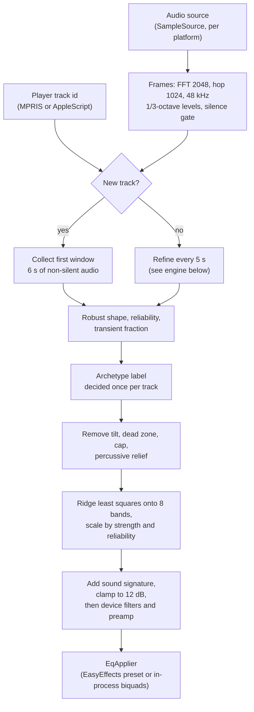
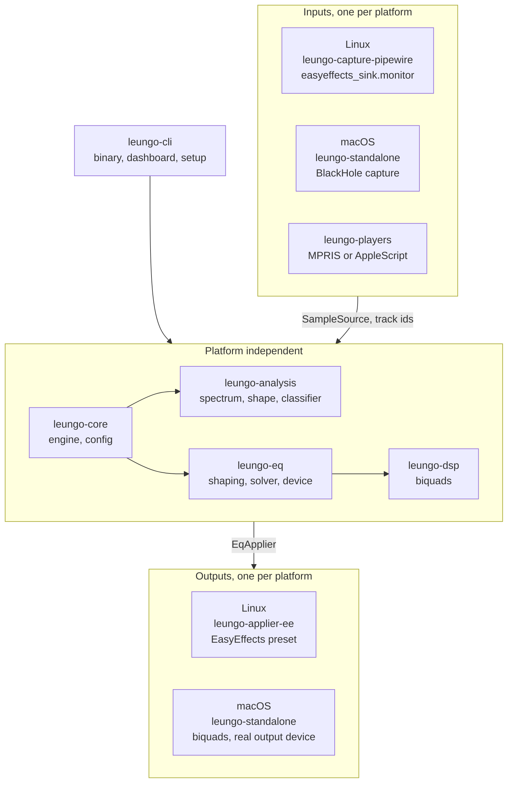
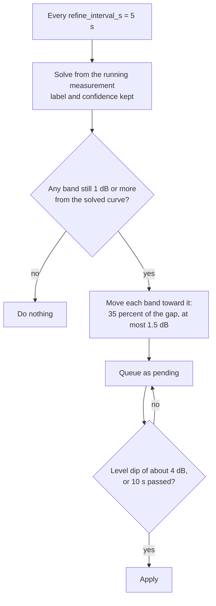
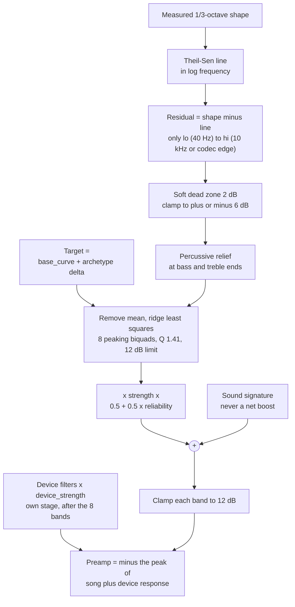

# Technical notes

How Leungo works inside. For using it, see the [README](README.md). For
changing it, see [CONTRIBUTING.md](CONTRIBUTING.md).

Numbers below are the shipped defaults (`crates/leungo-core/src/config.rs`).
Everything marked *unverified* has not been checked against real listening or
real hardware.

## Goal and approach

Leungo measures the music that is playing and applies a small, bounded
parametric EQ correction, per track. It does not try to make every song match
one target curve. It separates three things:

| Layer | What it is | Source of truth |
|---|---|---|
| Output device | Correction for the headphones or IEMs themselves | A measurement-based set of filters (`eq.device_filters`), fixed |
| Track | Bumps and dips in this song's balance that are outside normal | Measured live, per track |
| Taste | Bass, warmth, presence, air offsets | The user (`sound` controls) |

The track layer deliberately leaves the song's own spectral tilt alone and
corrects only the residual outside a dead zone. Treating "flat" as the target
makes every real recording look wrong, because music has an energy-per-band
slope.

## Data flow

Platform-specific code is limited to two traits in `leungo-core`:

- `SampleSource::next() -> SourceEvent` yields audio chunks (or an
  end-of-stream/device event).
- `EqApplier::apply_eq(&EqOutput)` and `set_bypass(bool)` push out the 8 song
  gains, the device filters and the preamp.

The engine knows nothing about PulseAudio, EasyEffects, CoreAudio or BlackHole.

## Crates

| Crate | Responsibility |
|---|---|
| `leungo-dsp` | RBJ biquads, magnitude response, direct-form-I state, shelf math |
| `leungo-eq` | Archetypes, target shaping, measurement import (CSV and ParametricEQ), the parametric device fitter, signature, the least-squares solver |
| `leungo-analysis` | FFT spectrum, features, robust shape tracker, detector, classifier (rule-based and fitted) |
| `leungo-core` | Config and presets, engine state machine, traits, paths, offline analysis |
| `leungo-capture-pipewire` | Linux capture through the PulseAudio API |
| `leungo-applier-ee` | Writes and loads the EasyEffects preset, bypass |
| `leungo-players` | Track ids and now-playing: MPRIS (Linux), AppleScript (macOS) |
| `leungo-standalone` | macOS engine: loopback capture, resampling, drift control, in-process filters |
| `leungo-cli` | The `leungo` binary, dashboard server, setup flows |

`leungo-capture-pipewire` is empty off Linux and `leungo-standalone`'s audio
I/O is behind the `audio-io` feature, so the workspace builds everywhere and the
pure logic (resampler, drift controller, filter chain) is tested on Linux.

## The engine

`leungo-core/src/engine.rs`. One thread, one loop over chunks from the source.

States: `Idle` (nothing analyzed yet, or the music stopped before the first
window was complete), `Analyzing` (collecting the first window), `Active` (a
curve is applied, refining). `Active` is left only by a new track.

1. **New track.** The player reports a new track id (or, with no player, a
   silence gap of `gap_s = 1.2` s followed by sound). The engine resets the
   spectrum memory and enters `Analyzing`. The id from the player is
   authoritative: pause and resume of the same id does not re-analyze, and a
   silence gap alone does not count as a new track when ids are available.
2. **First window.** After `window_s = 6` s of non-silent audio (or
   `max_wall_s = 20` s wall time) the engine measures, classifies, solves and
   applies the curve immediately. Nothing from the previous track is blended in.
3. **Refinement.** While `Active`, every `refine_interval_s = 5` s it
   re-solves from the running measurement and moves each band by at most
   `refine_max_step_db = 1.5` dB, and at most `refine_alpha = 35%` of the
   remaining gap. It acts only if some band still differs by at least
   `minimum_change_db = 1.0` dB.
4. **Deferred switching.** A refinement change is queued and applied at a
   quiet moment: a short dip in level of about `defer_dip_db = 4` dB below the
   recent average, or after `defer_max_s = 10` s regardless. New-track curves
   are never deferred.
5. **Archetype lock.** The archetype and its confidence are decided once from
   the first window and reused by refinement, so the target tilt does not flip
   between sections.

There is no section or "drastic change" detector. Section changes are followed
only through the slowly moving measurement.

The tuning presets (Conservative, Balanced, Aggressive) are a bundle of eight
of these values (strength, dead zone, cap, refine interval, refine fraction,
step, defer time, shape window). The preset is polled from a file (`tuning`) and applied
live; `Custom` uses the values in the config file.

## Measurement

`leungo-analysis`, mainly `robust.rs`, `spectrum.rs`, `subbass.rs` and `edge.rs`.

- **Level normalization.** Each frame's 1/3-octave levels are normalized by
  that frame's own overall level, so playback volume does not move the result.
- **Band edges.** Band levels on both grids weight each bin by the share of the
  bin that lies inside the band. Before this, whole-bin sums gave up to 1.4 dB of
  false bumps at 315 to 630 Hz on pink noise.
- **Sub-bass path.** The main FFT has ~23 Hz bins, too coarse for bass, so bass
  bands (1/3-octave centers up to 250 Hz) are measured on a second path. The
  signal is lowpassed (97-tap Blackman-windowed sinc, 3 kHz cutoff, flat to
  300 Hz, below -60 dB at frequencies that would alias onto 0 to 300 Hz) and
  decimated by round(fs / 6000), which is 8 at 48 kHz, about 6 kHz. A 2048-point
  Hann FFT then runs every 512 decimated samples, about 85 ms. Its bins are about
  2.9 Hz wide. L and R power are summed as on the main path. This path is used
  for the shape only.
- **Gating.** Frames more than 10 dB below the *median* frame level are
  ignored. The median, not mean power, is used so one loud burst cannot gate
  out the quiet majority. (An earlier mean-power gate, as in BS.1770, did that.)
- **Shape.** The per-band median over the last `shape_window_s = 20` s. Bass
  bands come from the sub-bass path. The tracker takes frames only once that
  path has its first window, about 0.35 s into a track.
- **Median bias.** The median of noise-like power sits below its mean. For power
  in n bins, the shape adds a per-band correction from a chi-square model with
  k = 2n / 1.5 degrees of freedom (the Hann noise bandwidth is 1.5 bins), using
  the Wilson-Hilferty approximation. Before this, one-bin bands read about 1.4 dB
  low.
- **Codec edge.** Taken from the plain mean power spectrum over the track's
  audible frames, once 5 s have been seen. The edge is the highest frequency
  where the level, smoothed to 1/12 octave, falls 25 dB or more within 1/6
  octave. The search starts at 4 kHz. The solver uses it for its upper limit
  (see Solver). The 25 dB threshold is *unverified* on real streams.
- **Reliability** (0..1). The first and second halves of the shape window are
  measured separately and compared: 1.0 means they agree, 0 means they differ by
  6 dB rms or more. It scales correction strength:
  `strength * (0.5 + 0.5 * reliability)`. It says how repeatable the
  measurement is, not whether the result sounds right.
- **Transient fraction.** The share of band energy that is a short excess over
  each band's own 9-frame temporal median. It is a proxy for percussive
  material, which is expected to have more bass and treble, so those
  corrections are reduced by `percussive_relief = 0.5`. The mapping from
  fraction to 0..1 (0.15 to 0.45) is a guess, *unverified* on real music; the
  values are logged so it can be fitted. This fraction uses main-grid
  (time-sharp) levels for every band. The sub-bass path is used for shape only.

Checks: on 60 s of pink noise, every band from 31.5 Hz to 16 kHz is within
±0.25 dB of the mean. The 25 Hz band reads +0.52 dB, since it is only about two
fine bins wide and below the correction floor.

The solver still picks its 1/3-octave points from the main grid and drops any
band that holds no main-grid bin, so the list starts at 25 Hz (20 Hz is
dropped at a 2048-point FFT at 48 kHz).

Offline analysis (`leungo analyze`) feeds the analyzer in 1024-frame chunks. One
large push made every hop move the whole remaining buffer. A 2 min file took
21 s that way and 0.4 s with chunks. On a 2 min stereo file the fine path raises
CPU time from 0.39 s to 0.50 s (user).

## Solver and target shaping

`leungo-eq`.

1. Take the measured 1/3-octave shape.
2. Fit a robust line to the shape in log-frequency (Theil-Sen: the median of
   all pairwise slopes, with a median intercept) and subtract it. A plain
   least-squares line is dragged by a wide bass bump and cancels its own
   correction; the median-slope fit does not.
3. Shrink the residual by `deadzone_db = 2` (soft threshold) and clamp it to
   `±residual_cap_db = 6`. Points below `lo` (40 Hz) or above `hi` get no
   correction. `hi` is 10 kHz, or `edge / 2^(1/3)` when the stream's lowpass
   is lower (see Measurement). The dead zone can be set per point, which is
   how percussive material is given more room.
4. Reduce the bass and treble ends of that residual by `percussive_relief`
   scaled by the transient fraction (`edge_weight` is 0 in the middle of the
   spectrum and 1 at the ends).
5. Solve for the band gains that move the residual toward the target
   `base_curve + archetype delta` (`leungo-core/src/config.rs::target_delta`).
   The mean is removed first, because a peaking EQ cannot apply a constant
   shift and overall level is loudness, not timbre. The fit is ridge-regularized
   least squares (`ridge = 0.05`) on the log-frequency axis, run twice with each
   band clamped to ±12 dB, onto **8 peaking biquads** at 63, 125, 250, 500, 1k,
   2k, 4k, 8k Hz with Q 1.41.
6. Multiply the track correction by `strength * (0.5 + 0.5 * reliability)`.
   Classifier confidence is **not** part of this; it is displayed and logged.
7. Add the sound signature gains, then clamp each band to ±12 dB. The device
   filters are a separate stage and are not summed into these 8 bands (see
   [Device profiles](#device-profiles)).

Headroom is a preamp, computed every time a curve is applied:
`preamp = -max(0, peak of the combined response)`, where the response is the
song bands plus the device filters, sampled on a 1/24-octave grid from 20 Hz
to 20 kHz. On Linux it is the equalizer `input-gain`; on macOS it is a smoothed
gain in the chain. The signature gains are still shifted so they never add a
net boost.

The 8 bands are the song layer only. They are too broad for narrow notches
(for example a 5 kHz IEM resonance), so the device stage has its own parametric
filters.

## Device profiles

`leungo device <files...> [--target <csv>]` accepts either AutoEq measurement
CSVs or AutoEq `ParametricEQ.txt` files, not a mix in one run.

- **CSV:** a `frequency,raw` header. AutoEq results CSVs with more columns also
  work; only the `raw` column is used. `--target` applies only to CSVs. The
  default target is Harman in-ear 2019, bundled at
  `crates/leungo-eq/targets/harman-in-ear-2019.csv` (from AutoEq, MIT, copied as
  `targets/LICENSE-AutoEq`).
- **ParametricEQ:** the AutoEq format (`Preamp`, then
  `Filter N: ON PK|LSC|HSC Fc … Gain … Q …`). These are already
  corrections, toward a target AutoEq chose (which one is *unverified*). Each
  file's response is evaluated on the grid, the files are averaged in dB
  (`consensus_db`), and the mean is refitted with the same fitter.

The CSV pipeline (`crates/leungo-eq/src/fr.rs`):

1. Each measurement is resampled onto a 1/12-octave grid from 20 Hz to 20 kHz
   and level-normalized so that 500 Hz to 1 kHz is 0 dB.
2. The sources are combined by per-point median.
3. The spread between sources gives a weight,
   `1 / (1 + (spread / 1.5 dB)^2)`. The 1.5 dB is *unverified*. With one
   source, the weight falls from 1 to 0.5 between 6 and 10 kHz.
4. The correction is weight x (target - measured), smoothed over 3 grid points.
   A boost may rise at most 3 dB above the median of its 1/3-octave
   neighbourhood. The cap is there because narrow dips are mostly canal
   resonances. The 3 dB is *unverified*. The correction fades to zero between
   8 and 12 kHz and is clamped to +6 / -12 dB.

The fitter (`crates/leungo-eq/src/fit.rs`) turns that correction into filters:

| Filter | Limits |
|---|---|
| Count | one low shelf, one high shelf, up to 8 peaking |
| Low shelf fc | 30 to 300 Hz |
| High shelf fc | 2 to 16 kHz |
| Shelf Q | 0.4 to 0.9 |
| Peaking fc | 20 Hz to 12 kHz |
| Peaking Q | 0.4 to 6; the maximum falls to 2 between 5 and 10 kHz, because treble peaks move with insertion depth (*unverified*) |
| Gain | within ±12 dB |

Placement is greedy: each new filter goes at the worst remaining error, with Q
taken from the width at half height. Then Levenberg-Marquardt adjusts all
parameters together. A gain penalty of 0.05 per dB² stops big filters from
stacking and cancelling. The fit stops at 0.5 dB rms, or when a new filter
improves the error by less than 0.1 dB. A level offset is fitted and thrown
away, because level is the preamp's job.

The result is written to `eq.device_filters` in the config, an array of tables
with `kind` (`"peak"`, `"low_shelf"` or `"high_shelf"`), `fc`, `gain_db` and `q`.
`leungo device` sets `eq.device_curve` to zeros so the correction is not applied
twice. Older configs with a non-zero `device_curve` still work as before.

The device filters are their own stage, scaled by `device_strength`. They are
not squeezed into the 8 song bands.

- **Linux:** written into the same EasyEffects equalizer as extra bands after
  the 8 song bands. Every band uses mode `APO (DR)` (RBJ cookbook math, the same
  as the fitter), with EasyEffects types Bell, Lo-shelf and Hi-shelf. Verified on
  EasyEffects 8.2.8: white noise was measured before (`easyeffects_sink.monitor`)
  and after EasyEffects (DAC monitor). The response matched the model within
  0.04 dB rms, worst 0.16 dB at 80 Hz. EasyEffects 7 support for `APO (DR)` is
  *unverified*.
- **macOS:** extra biquads in `leungo-standalone`'s chain. Gain changes are
  smoothed like the bands.

Measured example: KZ EDX Pro (Super Review and RikudouGoku, toward Harman in-ear
2019) fits to 7 filters with a 0.36 dB rms error. The old 8 fixed bands on the
same correction gave 1.12 dB rms (20 Hz to 8 kHz). crinacle's AutoEq folder for
this IEM has no raw CSV, only EQ files.

Using several independent measurements is deliberate: a single unit or coupler
can be an outlier. The profile data in `profiles/` is not published in the
repo, because the licensing of the underlying measurement data was not checked.

## Classifier

`leungo-analysis/src/classifier.rs`, `fitted.rs`.

Five archetypes: bass-heavy, vocal-centric, guitar-band, bright-acoustic,
neutral. The default classifier is rule-based: nearest prototype in a
four-number descriptor space (bass relative to mids, treble relative to mids,
crest factor, spectral centroid; see `descriptors`). Confidence is
the normalized margin to the runner-up prototype, so it is low by construction
(typically 10 to 25%) and is a "how clear is the boundary" number, not a
probability of being right.

The prototypes were set by hand and were not calibrated against music. A
`leungo fit` command fits them to the tracks logged in `tracks.jsonl`
(needs about 30 distinct tracks that form more than one group) and replaces
the margin with a probability. The archetype only changes the target by at most
1.5 dB before strength scaling, so its audible effect is small.

## Platform backends

### Linux

- **Capture.** The PulseAudio compatibility API (works on PipeWire via
  `pipewire-pulse`). When EasyEffects is running, the source is
  `easyeffects_sink.monitor`, the signal *before* the EQ chain, so the analysis
  never measures its own correction. Otherwise `@DEFAULT_MONITOR@`.
- **Apply.** The daemon writes the preset
  `~/.local/share/easyeffects/output/leungo.json` and asks EasyEffects to load
  it. The file carries both the EasyEffects 7 (`equalizer`) and 8
  (`equalizer#0`) keys.
- **Tracks.** MPRIS over D-Bus: `PropertiesChanged` on
  `org.mpris.MediaPlayer2.Player`, seeded at startup with each player's current
  track. `Metadata` values arrive wrapped in an extra variant layer, which an
  earlier version of the monitor mishandled.
- **Setup.** If the `easyeffects` command is not on `PATH` the dashboard shows
  the distro-specific install command and waits.

### macOS

macOS has no system audio tap and no EasyEffects, so `leungo-standalone` does
the whole job: capture the BlackHole loopback input, resample, filter with 8
in-process biquads plus the device filters (smoothed gain changes), and play to
the real output.

- **Clocks.** The two devices run on separate clocks. A small controller
  absorbs the drift. It is unit-tested against simulated drift and *unverified*
  on real hardware over long sessions.
- **Routing.** The app changes the system output to BlackHole while running and
  restores it on exit. A wrong or missing restore leaves the system pointed at
  BlackHole.
- **Tracks.** Spotify and Music are polled with AppleScript. Automation
  permission is requested on first use.
- **Latency.** About `latency_ms = 60` ms is added.

## State, config and files

| What | Where |
|---|---|
| Config | `~/.config/leungo/config.toml` |
| Saved choices next to the config | `classifier.json` (fitted classifier), `devices.json` (chosen devices), `ui.json` (simple or advanced), `route.json` (macOS output routing) |
| Runtime state | `~/.cache/leungo/`: `status.json`, `bypass`, `tuning`, `signature.json` |
| Track log (fitting input) | `~/.local/share/leungo/tracks.jsonl` |
| EasyEffects preset | `~/.local/share/easyeffects/output/leungo.json` |

Track log lines are now `"v": 3` and have an `edge_hz` field: the codec edge in
Hz, or `null` when no edge was found.

macOS uses the platform equivalents (`~/Library/Application Support/leungo`).
Directories left over from the earlier name `adaptive-eq` are migrated on first
run and never overwrite an existing `leungo` directory.

The config rejects unknown keys on purpose, so a typo fails loudly.

## Dashboard server

`leungo gui` runs the engine and a small HTTP server on `127.0.0.1:8431`. It
serves one self-contained page (`gui.html`, no external resources). It binds to
loopback only. There is no authentication, because it is not reachable from
other machines; any local process can use it.

| Route | Purpose |
|---|---|
| `GET /` | the page |
| `GET /api/state` | status, spectrum, now playing, gains, setup state |
| `GET /api/devices`, `POST /api/devices` | list and choose capture/output (macOS), or the fixed path (Linux) |
| `POST /api/bypass/on` and `/api/bypass/off` | adaptive layer on or off |
| `POST /api/tuning/<preset>` | tuning preset |
| `POST /api/sound` | sound signature and device strength |
| `POST /api/mode/simple` and `/api/mode/advanced` | UI mode |
| `POST /api/setup/install` | macOS: download and open the BlackHole installer |
| `POST /api/bye` | the window closed (used for quit-on-close) |

Window opening (`gui.open`): `app` launches a Chromium-family browser with
`--app=URL`, which is a chromeless window but still a browser process;
`browser` and `none` are the alternatives. There is no native toolkit window.

## Testing

- Unit tests live next to the code. The engine has integration tests
  (`crates/leungo-core/tests/engine.rs`) that drive it with synthetic audio and
  a recording applier. They cover: every new track is analyzed and applied,
  a pause and resume of the same track keeps its preset, refinement waits for a
  quiet moment, the label is decided once per track, the same track gets the
  same curve whatever came before it, and playback level does not change the
  curve.
- Synthetic signals only. There is no regression corpus of real music, because
  none is available to ship. The values most dependent on real music
  (percussive mapping, dead zone, strength) are therefore *unverified by test*.
- CI builds, lints and tests on Linux and on an Apple silicon macOS runner. The
  cpal audio code is compiled there but not executed against a device.

## Known gaps

- `eq.base_curve` is part of the target the solver fits, so it is scaled by
  `strength` along with everything else in the track correction. A curve meant
  to be applied in full belongs in the device stage (`eq.device_filters`), which
  `strength` does not scale.
- No per-output-device profiles: one device correction is applied to whatever is
  playing.
- No awareness of playback level (equal-loudness effects), because the monitor
  signal is taken before the volume control.
- The classifier is weak and the genre labels are coarse; a style prior from
  metadata was investigated (MusicBrainz) but not built.
- 8 bands and ±12 dB: not a room correction or a precise headphone EQ.
- Tonal peaks versus mix balance (song key) are not handled yet.
- The percussiveness mapping (0.15 to 0.45) is still uncalibrated. On pink noise
  the transient fraction moved from 0.27 to 0.22 with the measurement changes.
- The measurement changes (sub-bass path, codec edge, bias correction) are not
  yet verified by ear.
